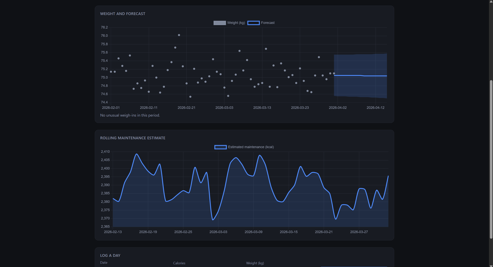
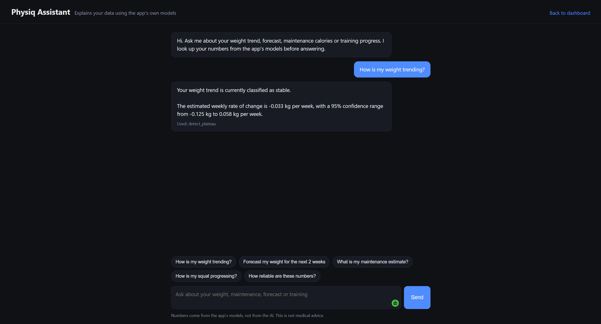
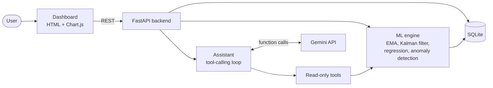
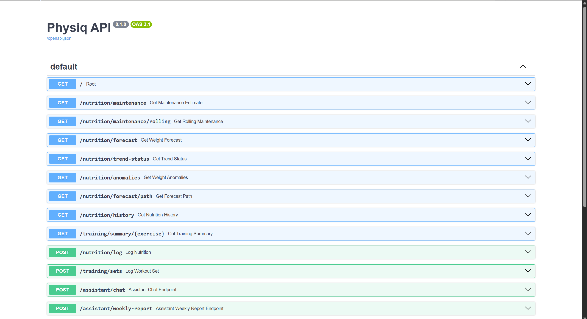

# Physiq

Nutrition and training analytics with a statistical ML core and an AI explanation layer.

Log daily weight and calories plus workout sets. Physiq estimates your maintenance calories, tracks your true weight trend, forecasts weight with uncertainty ranges, flags unusual weigh-ins, and tracks strength progress. An AI assistant explains the results in plain language, but every number it states comes from the models, not from the AI.

Inspired by the adaptive-expenditure idea in MacroFactor and the logging flow of Strong. Not affiliated with either; the methods here are independent implementations of standard techniques.



## Features

- **Weight trend**: time-aware exponential moving average that handles missing days
- **Maintenance calories**: estimated from the weight trend and logged calories, updated on a rolling window
- **Weight forecast**: Kalman-filter local linear trend with a 90% prediction interval
- **Trend status**: gaining, losing, stable or uncertain, with a confidence range on the weekly rate
- **Anomaly detection**: flags weigh-ins far from what the trend predicted
- **Training progress**: top set per session, estimated 1RM, personal records, volume
- **AI assistant**: answers questions by calling read-only tools that wrap the models
- **Weekly report**: one AI-written summary generated from the model results



## Architecture



The language model never computes anything. It can only call six read-only tools, and each tool runs the same validated code that powers the dashboard. Tool results carry units, and the system prompt forbids stating figures that did not come from a tool.

## How the models work and how they were validated

All validation uses simulated data with a known ground truth (a physiological weight model plus scale noise). There has been no validation on real users yet.

| Component | Method | Result on simulated data |
|---|---|---|
| Weight trend | Exponential moving average, alpha chosen by grid search | Alpha 0.1 minimised error against true weight (mean absolute error 0.051 kg) |
| Maintenance calories | Slope of the smoothed trend plus mean logged calories, 7700 kcal per kg | Mean error -1.5 kcal (SD 13.5) over 5 runs; typically within about 1% of the true value |
| Missing days | Calendar-day regression and time-aware smoothing | With 25% of days unlogged, the naive row-based method was off by about +105 kcal; the fixed method matches the no-gap result |
| Weight forecast | Kalman-filter local linear trend, parameters fitted by maximum likelihood | Held-out error 3-11% lower than a straight-line fit; 90% interval covered 90-94% of actual weigh-ins |
| Anomaly detection | Standardised one-step prediction error from the Kalman filter, threshold 3 | Caught 94% of 2.0 kg spikes, 62% of 1.2 kg, 22% of 0.8 kg (scale noise 0.3 kg); about 0.2 false alarms per 90 days |
| Training trend | Session top set smoothed with an EMA | Session maximum sits about 0.66 kg above true strength because it is the best of several noisy sets |

Forecast results on held-out simulated runs (14-day horizon, error in kg):

| Scenario | Linear fit | Kalman | 7-day average | Kalman interval coverage |
|---|---|---|---|---|
| Flat weight | 0.298 | 0.266 | 0.262 | 0.909 |
| Mild deficit | 0.298 | 0.267 | 0.398 | 0.921 |
| Deficit | 0.298 | 0.283 | 0.893 | 0.925 |
| Surplus | 0.298 | 0.291 | 0.874 | 0.937 |
| Deficit, 25% days missing | 0.299 | 0.289 | 0.896 | 0.896 |

When weight is flat, a plain 7-day average is about as good as the Kalman forecast. When weight is changing, the Kalman forecast is far better.

## Limitations

- Validated on simulated data only; real-world accuracy may be lower.
- Maintenance estimates depend on honest, complete calorie logging. Unlogged days are assumed to resemble logged days.
- Scale weight is noisy (water, food, timing), so short forecasts carry wide ranges.
- Forecasts assume the recent trend continues.
- Single user, no authentication.
- The AI assistant uses the Gemini free tier, which has low rate limits, and Google states that free-tier content may be used to improve its products. Do not send real personal data through it.
- Not medical advice.

## Tech stack

Python, pandas, NumPy, SciPy, scikit-learn, FastAPI, SQLite, Chart.js, Gemini API (google-genai), pytest, GitHub Actions.

## Run it locally

```
python -m venv venv
venv\Scripts\activate
pip install -r requirements.txt
python src/synthetic_generator.py
python src/workout_generator.py
python src/database.py
uvicorn main:app --reload
```

Serve the dashboard from a second terminal:

```
cd frontend
python -m http.server 5500
```

Open `http://127.0.0.1:5500`. The AI assistant and weekly report need a free Gemini API key from Google AI Studio. Put it in a file named `.env` in the project root:

```
GEMINI_API_KEY=your-key-here
```

Everything else works without it. On macOS or Linux, activate with `source venv/bin/activate` and install from `requirements-ci.txt` plus `uvicorn`.

Run the tests:

```
python -m pytest
```

## API

Interactive docs at `http://127.0.0.1:8000/docs`.

| Method | Path | Purpose |
|---|---|---|
| GET | `/nutrition/maintenance` | Maintenance estimate with logging coverage |
| GET | `/nutrition/maintenance/rolling?window=30` | Rolling maintenance estimate |
| GET | `/nutrition/forecast?days=14` | Weight forecast with 90% interval |
| GET | `/nutrition/forecast/path?days=14` | Day-by-day forecast path |
| GET | `/nutrition/trend-status` | Gaining, losing, stable or uncertain |
| GET | `/nutrition/anomalies?threshold=3` | Unusual weigh-ins |
| GET | `/nutrition/history?days=60` | Recent weight and calories |
| GET | `/training/summary/{exercise}` | Sessions, trend, volume, PRs |
| POST | `/nutrition/log` | Log a day (upserts by date) |
| POST | `/training/sets` | Log a set |
| POST | `/assistant/chat` | Ask the assistant |
| POST | `/assistant/weekly-report` | Generate the weekly report |



## Project layout

```
main.py                   FastAPI app
src/
  smoothing.py            EMA trend (plain and time-aware)
  nutrition.py            maintenance estimation and logging coverage
  kalman.py               local linear trend filter, forecast, innovations
  forecasting.py          forecast dispatcher, trend status, backtesting
  anomalies.py            weigh-in anomaly detection
  training.py             1RM, PRs, volume, exercise summaries
  database.py             SQLite access
  assistant.py            Gemini tool-calling loop and weekly report
  assistant_tools.py      read-only tools and model explanations
  synthetic_generator.py  simulated nutrition data
  workout_generator.py    simulated workout data
frontend/                 dashboard and assistant pages
notebooks/                exploration and validation experiments
tests/                    67 tests
```